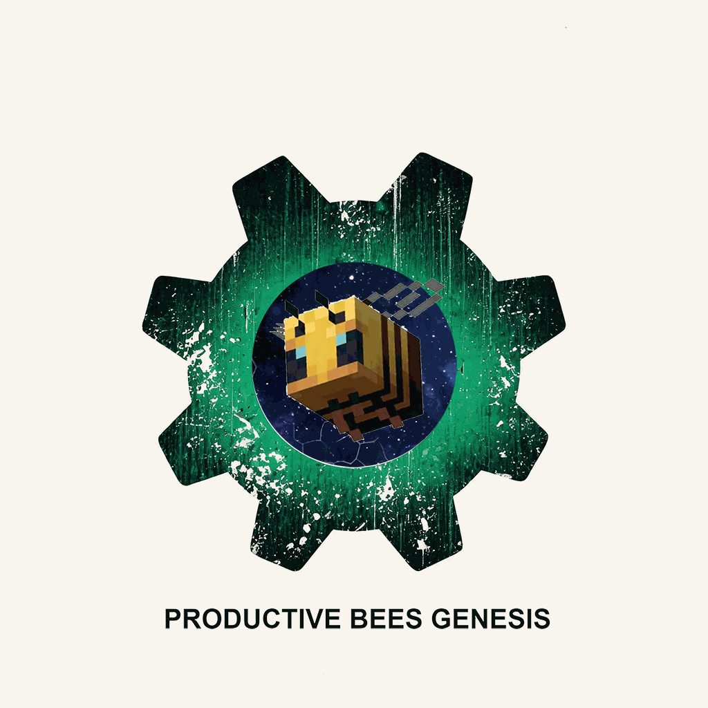

# Productive Bees Genesis

**From bees to an automated production line.**

A **Productive Bees + Mekanism** addon for **Minecraft 1.21.1 / NeoForge**. Raise bees in powered apiaries, process their combs in factories, and design your own resource bees with an in-game editor.

[](https://github.com/Ayoshiko/productive-bees-genesis/releases/tag/v1.2.5)


**[CurseForge download](https://www.curseforge.com/minecraft/mc-mods/productive-bees-genesis) · [GitHub Releases](https://github.com/Ayoshiko/productive-bees-genesis/releases) · [Changelog](CHANGELOG.md) · [中文](README_zh.md)**

[Install](#installation) · [Get started](#first-production-line) · [Features](#features) · [Bee Designer](#bee-designer) · [Resource bees](#extended-resource-bees) · [Help](#guides-and-configuration)

## Installation

Use **Minecraft 1.21.1 and Java 21**. Install these required mods and their own dependencies, then place the Genesis JAR in the instance’s `mods` folder:

| Required component | Minimum version |
| --- | --- |
| [NeoForge](https://neoforged.net/) | 21.1.214 |
| [Productive Bees](https://www.curseforge.com/minecraft/mc-mods/productive-bees) | 1.21.1-13.13.5 |
| [Mekanism](https://www.curseforge.com/minecraft/mc-mods/mekanism) | 10.7.14.79 for Minecraft 1.21.1 |

Install matching Genesis versions on **both client and server**, and update them together. Mekanism is required for the mod; AE2 and the other integrations below are optional.

**Helpful additions:** JEI for recipes and flowers, Jade for machine status, and Patchouli for the craftable **Productive Bees Genesis Guide**.

This page covers the NeoForge edition. For Forge 1.20.1, see the separate [Forge branch](https://github.com/Ayoshiko/productive-bees-genesis/tree/forge/1.20.1).

## First production line

**Bees + flowers + FE → MEK Apiary → combs → MEK Centrifuge → products**

1. Craft a **MEK Apiary** and supply FE. Use JEI to check the recipes in your pack.
2. Insert bees with filled cages and put their required flowers or materials in the **Feeder**. Simulation is built in; no simulation card is needed. Bee activity and weather requirements still depend on the balance settings.
3. Place a **MEK Centrifuge** beside it, supply power, and configure the apiary’s item output toward the centrifuge. Enable **centrifuge priority** to send combs there first.
4. Connect item and fluid outputs to storage. Once the line works, add factory tiers, upgrades or optional ME-network automation.

Feeder items normally act as reusable flowers. Enabling item/block conversion consumes materials according to the selected recipe.

With Patchouli installed, craft the player guide using a **book + honeycomb + empty Bee Cage or empty Sturdy Bee Cage**. You can also read the [getting-started guide](src/main/resources/assets/productivebeesgenesis/guides/productivebeesgenesis/guide/_en_us/getting_started/index.md) in this repository.

## Features

| System | What it adds |
| --- | --- |
| **MEK Apiaries** | Powered bee production with internal feeders, cage transfer, gene treats, paged outputs and Mekanism side controls. |
| **MEK Centrifuges** | Process PB combs and comb blocks into items and fluids; separate fluid tanks and optional Energized Smelter recipes. |
| **Factory progression** | Basic, Advanced, Elite and Ultimate factories for both machines; optional Mekanism addons provide higher tiers. |
| **Myriad Creations Bee** | Random comb output drawn from allowed resource bees, with configurable acquisition, appearance and blacklist/whitelist filters. |
| **Upgrades** | Combine Mekanism upgrades with PB productivity, time, gene-sampling and other machine-specific upgrades. |
| **Authoring tools** | Create bees, acquisition recipes and resource outputs in the Bee Designer; share datapacks, KubeJS bundles and portable collections. |

### Automation and upgrades

Basic item/fluid transport and adjacent centrifuge delivery work without AE2. With **AE2**, machines can output directly to ME storage; centrifuges can pull inputs using filters, quantity limits and network reserve settings. Apiaries can also restock matching gene treats.

ME connections need power, channels, compatible storage and the relevant machine toggles. Machines can draw native AE energy; **Applied Flux** adds access to FE stored in ME. If you want to use only that FE, disable native AE energy input in the machine.

The **Basic** balance preset is the default: centrifuge productivity adds parallelism without multiplying each batch’s output, and productivity/time tiers cannot be mixed. **Paradox Infinity** permits stronger combinations; **Custom** exposes the individual rules.

Functional upgrades add **essence conversion** for supported crafting recipes, **raw-ore smelting** in centrifuges, **byproduct destruction**, and **type-only / full-purity genes** in apiaries. Gene modifiers require a gene sampler; byproduct destruction intentionally discards the specified byproducts.

## Bee Designer

In **Creative mode**, obtain the **BeeBee Support Handbook** (`productivebeesgenesis:bee_designer`) and right-click it. This opens the editor; the survival guide above is a separate book.

**Choose or create a bee → edit → validate → apply to the world or export.**

- Edit configurable bees’ appearance, genes, flowers, acquisition and outputs with a live preview. Native bees expose the recipe fields their host supports.
- Save local drafts, copy bees, review changes, and import/export multiple bees as portable collections. Browse another local modpack to select projects to bring across.
- Export datapacks and names, or a **KubeJS author bundle** containing definitions, assets and recipe scripts.
- Add bee-egg recipes to machines already defined in the pack. Supported hosts are **Modern Industrialization** (2.5.8 / 2.5.10), **Multiblocked2** (21.1.1.a / 21.1.2) and **Modular Machinery Reborn** (3.0.20 / 3.0.22).

On a dedicated server, applying changes requires **Creative mode and OP level 2**. Creative players without OP can work with local drafts and exports. Saving a draft does not change the world.

The editor includes a guided tour. **Settings → File Locations** shows draft, export and archive folders. Portable collections retain project data and attribution; the destination pack still needs the referenced mods, textures and machine definitions.

## Extended resource bees

Custom bees can produce **FE, chemicals, Source, EMC and other resources**, either directly or through comb processing. Use **Genesis apiaries, centrifuges and their factories** for these recipes; PB’s own machines continue to handle ordinary PB outputs.

Bee appearance and acquisition use PB JSON. Genesis adds `resource_production`, `resource_centrifuging` and container-content flowers (`flowerResource`). A filled container used as a flower is checked without consuming its contents.

<details>
<summary>Resource types and optional ME bridges</summary>

| Resource / recipe kind | Resource provider | For ME output |
| --- | --- | --- |
| FE · `energy` | Built in | Applied Flux |
| Chemicals · `chemical` | Mekanism | Applied Mekanistics |
| Source · `source` | Ars Nouveau | Ars Énergistique |
| Souls · `soul` | Industrial Foregoing Souls | Soulplied Energistics |
| Compressed air · `air` | PneumaticCraft | Applied Pneumatics |
| EMC · `emc` | ProjectE | Credits the machine owner’s ProjectE account |
| Experience · `experience` | ExperienceLib | Applied Experienced |
| Lightning · `lightning` | AE2 Lightning Tech | AE2 Lightning Tech |
| AE2 resource · `ae_key` | AE2 and the resource’s provider | Matching key support and accepting storage |

Resources with native output support can go directly to the corresponding machines without an ME connection. ME output requires AE2 plus the corresponding bridge, power, a channel and suitable storage. Produced FE is separate from operating power; EMC is credited to an account rather than a storage slot.

</details>

**Start with an example:** [Copper energy bee](examples/resource-bees/datapack/data/example/productivebees/copper_energy.json) · [FE output recipe](examples/resource-bees/datapack/data/example/recipe/copper_energy_production.json) · [Field reference](examples/resource-bees/field-notes.json).

After installing the examples, look up the copper energy bee’s egg recipe in JEI. Put the bee in a powered apiary with a copper ingot in its feeder to produce FE directly.

**Optional example packs:** [Download the bundle](https://github.com/Ayoshiko/productive-bees-genesis/releases/download/resource-bee-examples-1.1.0/resource-bees-all.zip) · [Installation](examples/resource-bees/INSTALL.txt) · [Datapack sources](examples/resource-bees/datapack) · [KubeJS examples](examples/resource-bees/kubejs/server_scripts).

Examples are distributed separately and are **not included in the mod JAR**. Choose either the datapack or the complete KubeJS installation; do not install both for the same bees. Annotated `.jsonc` files are references, not runnable game JSON.

For scripts, `MyriadBeeEvents.register` provides acquisition and recipe helpers during server recipe loading/reloading. Bee definitions remain PB JSON; extended recipes can use `event.custom(...)`. See the [KubeJS implementation](src/main/java/com/ayoshiko/productivebeesgenesis/compat/kubejs) and [Java API example](examples/resource-bees/api/ResourceBeeApiExample.java) for developer entry points.

## Optional integrations

Install only the integrations you want; keep each addon’s own dependencies and version requirements in mind.

| Area | Optional mods and support |
| --- | --- |
| Higher factory tiers | **Mekanism Extras**, **Evolved Mekanism**, **Evolved Mekanism Extras**. |
| Additional upgrades | **Mekanism Unleashed** extends limits; **Mekanism Empowered** or **Empowered Unleashed** adds six upgrades to both machines. |
| ME automation | **AE2** for network logistics; **Applied Flux** for stored FE; resource-specific bridges are listed above. |
| Recipes and machine information | **JEI**, **Jade**, **Patchouli**, **GuideME**. |
| Pack authoring | **KubeJS** and the supported machine hosts listed under Bee Designer. |
| Transport and visuals | **Super Factory Manager** through standard item/fluid/energy capabilities; **Iris** compatibility for cosmic rendering. |

Use either **Empowered + its matching Core**, or the merged **Empowered Unleashed**. Do not combine the merged addon with original Empowered or standalone Mekanism Unleashed.

## Guides and configuration

The [player guide](src/main/resources/assets/productivebeesgenesis/guides/productivebeesgenesis/guide/_en_us/index.md) contains the detailed controls and recipes. Its text is readable here; game-specific icons and interactive examples are available in game.

| Find an answer | Guide |
| --- | --- |
| Machine slots, feeders and output faces | [Apiary](src/main/resources/assets/productivebeesgenesis/guides/productivebeesgenesis/guide/_en_us/machines/apiary.md) · [Centrifuge](src/main/resources/assets/productivebeesgenesis/guides/productivebeesgenesis/guide/_en_us/machines/centrifuge.md) |
| Upgrade effects and balance | [PB upgrades](src/main/resources/assets/productivebeesgenesis/guides/productivebeesgenesis/guide/_en_us/upgrades/pb-upgrades.md) |
| ME input filters and logistics | [AE2 input](src/main/resources/assets/productivebeesgenesis/guides/productivebeesgenesis/guide/_en_us/upgrades/ae2-input.md) · [Automation](src/main/resources/assets/productivebeesgenesis/guides/productivebeesgenesis/guide/_en_us/upgrades/automation.md) |
| Myriad acquisition and comb filtering | [Myriad Creations Bee](src/main/resources/assets/productivebeesgenesis/guides/productivebeesgenesis/guide/_en_us/myriad.md) |
| Custom bees, resource recipes and output faces | [Resource bee tutorial](src/main/resources/assets/productivebeesgenesis/guides/productivebeesgenesis/guide/_en_us/configuration.md#custom-bees-and-extended-resources) |
| Tuning or a stalled machine | [Configuration](src/main/resources/assets/productivebeesgenesis/guides/productivebeesgenesis/guide/_en_us/configuration.md) · [Troubleshooting](src/main/resources/assets/productivebeesgenesis/guides/productivebeesgenesis/guide/_en_us/troubleshooting.md) |

Open **Mods → Productive Bees Genesis → Config**. Start with the default balance settings; multiplayer production rules come from the server. Client/common settings are separate from these world-specific files in `<world>/serverconfig/`:

| Server configuration | Scope |
| --- | --- |
| `productivebeesgenesis-gameplay-server.toml` | Myriad rules, filters and balance presets. |
| `productivebeesgenesis-machines-server.toml` | Machines, upgrades, energy and logistics. |
| `productivebeesgenesis-capacities-server.toml` | Per-tier input/output and fluid capacity settings. |

**Capacity changes require reopening the world or restarting the server.** Older single-file configurations are migrated; use the current configuration screen and generated files.

If production stops, check the bee-slot tooltip or Jade, power, flowers, redstone controls and output space. For ME problems, also check channels and machine toggles. The troubleshooting guide covers pending outputs and cases that need operator attention.

## Build from source

Requires **JDK 21**, **Python 3.11+** and internet access.

```bash
git clone --branch main-neo/1.21.1 https://github.com/Ayoshiko/productive-bees-genesis.git
cd productive-bees-genesis
python3 .github/scripts/build_dependencies.py
./gradlew build --no-daemon
```

On Windows, use `python` or `py -3`, and `.\gradlew.bat`. The dependency script prepares and checks the pinned development JARs listed in [development-dependencies.json](gradle/development-dependencies.json).

The JAR is written to `build/libs/`, with its version set in [gradle.properties](gradle.properties). Normal `build` compiles and packages; run tests and example checks explicitly as needed. Release maintainers can refer to [PLATFORM_RELEASE.md](PLATFORM_RELEASE.md).

## Feedback and contributions

[Report a bug or request a feature](https://github.com/Ayoshiko/productive-bees-genesis/issues) with your Minecraft, loader and mod versions, reproduction steps, and the relevant `logs/latest.log` excerpt.

Translations live in [the language directory](src/main/resources/assets/productivebeesgenesis/lang). Submit a PR or attach a translation to an issue. Use the matching platform branch: `main-neo/1.21.1` for NeoForge / Java 21, or `forge/1.20.1` for Forge / Java 17. The `bees-processing-network/1.21.1` branch is separate experimental development.

## License and credits

Project-owned content covered by the [MIT License](LICENSE) remains under MIT. Third-party code, fonts and artwork retain their own terms. See [NOTICE](NOTICE), [third-party licenses](THIRD_PARTY_LICENSES.md) and the [file manifest](gradle/license-manifest.json) for attribution and unresolved provenance or permission records.

Thanks to **gummyc_type2**, author of **beebeeblock-the-skyhive**, for the original BeeBee Support Handbook texture, recolored yellow here; and to the Productive Bees, Mekanism, NeoForge, Re:Avaritia, AE2, Mek-Energistics, UselessMod, Applied Flux, KubeJS and Jade teams.
