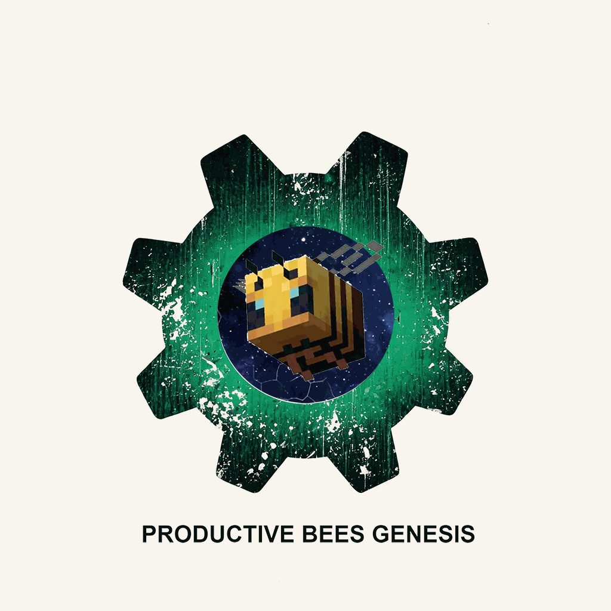

# 资源蜜蜂：创世

**从饲养蜜蜂，到自动化生产线。**

面向 **Minecraft 1.21.1 / NeoForge** 的 **Productive Bees（资源蜜蜂）+ Mekanism（通用机械）** 附属。用电力蜂箱养蜂、工厂离心处理蜜脾，也可以通过游戏内编辑器设计自己的资源蜜蜂。

[](https://github.com/Ayoshiko/productive-bees-genesis/releases/tag/v1.2.6)


**[CurseForge 下载](https://www.curseforge.com/minecraft/mc-mods/productive-bees-genesis) · [GitHub Releases](https://github.com/Ayoshiko/productive-bees-genesis/releases) · [更新记录](CHANGELOG.md) · [English](README.md)**

[安装](#安装) · [快速上手](#第一条生产线) · [主要功能](#主要功能) · [蜜蜂编辑器](#蜜蜂编辑器) · [扩展资源](#扩展资源蜜蜂) · [指南与配置](#指南与配置)

## 安装

使用 **Minecraft 1.21.1 和 Java 21**。安装以下必需组件及其自身前置，再将 Genesis JAR 放入当前游戏实例的 `mods` 文件夹：

| 必需组件 | 最低版本 |
| --- | --- |
| [NeoForge](https://neoforged.net/) | 21.1.214 |
| [Productive Bees（资源蜜蜂）](https://www.curseforge.com/minecraft/mc-mods/productive-bees) | 1.21.1-13.13.5 |
| [Mekanism（通用机械）](https://www.curseforge.com/minecraft/mc-mods/mekanism) | 适用于 Minecraft 1.21.1 的 10.7.14.79 |

**客户端与服务端均需安装相同版本的 Genesis，并一起更新。** Mekanism 是整个模组的必需依赖；AE2 及下方其他集成为可选。

**推荐搭配：** JEI **19.36.0.360 或更高版本**可用于查看配方与花源，Jade 查看机器状态，Patchouli 提供可合成的 **《资源蜜蜂：创世指南》**。

本页介绍 NeoForge 版。Forge 1.20.1 请查看独立的 [Forge 分支](https://github.com/Ayoshiko/productive-bees-genesis/tree/forge/1.20.1)。

## 第一条生产线

**蜜蜂 + 花源 + FE → 通用机械蜂箱 → 蜜脾 → 通用机械离心机 → 产物**

1. 合成**通用机械蜂箱**并供给 FE。整合包中的实际合成配方以 JEI 为准。
2. 用装有蜜蜂的蜂笼放入蜜蜂，在**喂食槽**放入对应花源或材料。模拟能力已经内置，无需安装模拟升级；蜜蜂的昼夜与天气条件仍受平衡设置影响。
3. 在旁边放置**通用机械离心机**并供电，将蜂箱物品输出面朝向它。开启**离心机优先**，优先把蜜脾送去加工。
4. 为物品和流体接好存储，再按需要升级工厂、安装升级卡或接入 ME 网络。

喂食材料默认只作为可重复使用的花源；开启物品／方块转化后，会按所选配方消耗材料。

安装 Patchouli 后，可用**书 + 原版蜜脾 + 空蜂笼或空坚固蜂笼**合成玩家指南。也可以直接阅读仓库中的[入门指南](src/main/resources/assets/productivebeesgenesis/guides/productivebeesgenesis/guide/getting_started/index.md)。

## 主要功能

| 系统 | 可以做什么 |
| --- | --- |
| **通用机械蜂箱** | 用 FE 驱动蜜蜂生产，内置喂食、蜂笼转移、基因小食、分页产物槽和 Mekanism 侧面控制。 |
| **通用机械离心机** | 处理 PB 蜜脾与蜜脾块，输出物品和流体；支持流体分槽及按需开启的电力熔炼炉配方。 |
| **工厂进阶** | 两类机器均有基础、高级、精英、终极工厂；可选 Mekanism 扩展提供更高等级。 |
| **万象创世蜜蜂** | 从允许的资源蜜蜂中随机产生蜜脾，可配置获取方式、外观和黑白名单过滤。 |
| **升级体系** | 组合 Mekanism 升级与 PB 产量、时间、基因采样等升级，各机器支持对应功能。 |
| **作者工具** | 用蜜蜂编辑器制作蜂种、获取配方和资源产物，分享数据包、KubeJS 作者包和便携蜜蜂合集。 |

### 自动化与升级

基础物品／流体物流和相邻离心机直连均可独立使用。安装 **AE2** 后，机器可以将产物直接送入 ME 存储，离心机可按过滤器、数量和网络库存保留量取料，蜂箱还可补充组件匹配的基因小食。

ME 连接需要电力、频道、可接收的存储和对应机器开关。机器可以使用 AE2 原生能量；安装 **Applied Flux** 后，还可使用 ME 中存储的 FE。若只希望使用这些 FE，可在机器中关闭原生 AE 能量输入。

默认使用**基础**平衡预设：离心机产量升级增加并行，不放大每批产量，产量／时间升级不能混装不同等级。**悖论无限**允许更强的组合，**自定义**可单独调整各项规则。

功能升级包括用于符合规则合成配方的**精华转化**、离心机的**粗矿熔炼**、**副产物销毁**，以及蜂箱的**仅基因种类／基因满纯度**。基因插件需配合基因采样器；副产物销毁会实际丢弃指定副产物。

## 蜜蜂编辑器

在**创造模式**取得**蜂蜂应援手册**（`productivebeesgenesis:bee_designer`），右键打开编辑器。JEI 可搜索“蜂蜂”“fengfeng”“蜜蜂编辑器”或完整物品 ID。它与上面的生存玩家指南是不同物品。

**选择或新建蜜蜂 → 编辑 → 校验 → 应用到世界或导出。**

- 实时预览可配置蜜蜂，编辑外观、基因、花源、获取方式和产物；原生蜜蜂开放其宿主支持的配方字段。
- 保存本地草稿、复制蜜蜂、检查改动，批量导入／导出便携合集，也可浏览其他本地整合包并选择要迁入的项目。
- 导出数据包和名称资源，或包含蜂种定义、资源与配方脚本的 **KubeJS 作者包**。
- 为整合包中已定义的机器编写蜂蛋获取配方。支持 **Modern Industrialization**（2.5.8／2.5.10）、**Multiblocked2**（21.1.1.a／21.1.2）和 **Modular Machinery Reborn**（3.0.20／3.0.22）。

获取页的九宫格可直接从背包或 JEI 拖入材料，**有序／无序**小按钮与简短规则同行，选中模式高亮，完整说明可悬浮查看。有序配方的重复材料保存为 `ABA`／`key`；无序配方保留材料数量。普通 KubeJS 合成使用 `event.shaped/shapeless` 简写，精确组件、条件与扩展字段保留完整声明。多选蜜蜂后进入导出页的**批量蜂蛋配方**，可用一条获得／机器配方生成各蜂草稿，再从草稿库一起应用。状态栏可悬浮查看修改摘要，点击字段跳转编辑。

外观和发布总览中可直接填写**蜂种 ID**；未完成或无效输入随草稿保留。已有可配置蜂种使用作者迁移，旧蜂、蜂蛋和蜜脾在正常读取／保存时转到新身份，保留已付生产进度与产物。世界应用后目录只显示新蜂，兼容映射仍随发布文件保留。万象的配置身份和原生实体蜂不在此迁移范围。

升级到 **1.2.7** 后，旧版注册蜂的中文拼音搜索在首次 JEI 加载时自动修复，同时支持英文名称和完整蜂种 ID；无需打开编辑器或重新应用。首次打开编辑器也会自动校验已加载内容，并继续读取已选择的蜂种。

导出／安装使用一个入口，按目的提供五项选择。做整合包推荐**直接安装**：已用 KubeJS 选 KubeJS；不用 KubeJS 选数据包，默认**当前实例所有世界**，安装一次、重启后新建和已有存档都生效。普通 PB 内容希望脱离创世运行时，再改选**当前世界**。给别人文件选 ZIP，保留设计选蜜蜂工程备份。ZIP 保存在本机，可修改文件名、预览文件，同名不覆盖；多选返回时保留选择。

只想在当前世界试用，可在目录、草稿库或导出页选择**应用到世界**。运行 ZIP 或直接安装还可勾选完成后应用：先保存同一快照的文件，再沿原批量事务应用并重载，两步结果分别显示；世界应用失败仍保留文件。工程备份不提供这个联动开关。

| 选项 | 适合谁 | 文件与作用范围 |
| --- | --- | --- |
| **直接安装 · 数据包** | 不用 KubeJS；按需要选择范围 | **当前世界**写入 `saves/<世界>/datapacks/bee-designer/`，名称写入并启用标准资源包 `resourcepacks/bee-designer/`。普通 PB 内容无需创世，重新进入世界加载。**当前实例所有世界**写入实例 `datapacks/bee-designer/`，由创世自动加载数据及名称；重启后新旧世界可用，发布时保留此目录与创世。多人服务器使用 ZIP 交管理员安装。 |
| **直接安装到实例 · KubeJS** | 已使用 KubeJS 的整合包作者 | 写入 `kubejs/data`、`kubejs/assets`、`kubejs/server_scripts`；重启后实例各世界可用。已有名称合并，替换前备份。普通 PB 内容无需创世。 |
| **导出 ZIP · 数据包** | 玩家、服务器管理员、手动安装者 | 主 ZIP 放目标世界 `datapacks`，配套 `-names.zip` 放各客户端 `resourcepacks` 并启用。主包只作用于安装它的世界；服务端 `/reload` 或重启。普通 PB 内容无需创世。 |
| **导出 ZIP · KubeJS** | 手动分发运行文件或交给其他作者 | 一个 ZIP，解压其中 `kubejs/` 到实例根目录，与 `mods/` 同级；需要 KubeJS，首次安装后重启。普通 PB 内容无需创世。 |
| **导出 ZIP · 蜜蜂工程备份** | 保留设计、跨实例继续编辑 | 仅保存本次所选蜜蜂的编辑源稿：属性、外观设置、名称、完整配方声明和作者／来源信息，包含已读取草稿及当前未保存编辑。用编辑器导入成草稿；保存和导入不会新增世界蜜蜂。 |

**无需创世仍须安装 Productive Bees 本体及内容引用的其它模组。** 普通 PB 蜂种属性、外观、合成获取、蜂箱产物和 PB 离心配方可独立运行，使用创世命名空间的自定义蜂种 ID 也不等于依赖创世。扩展资源生产／离心、容器内容花源、创世物品或组件、旧 ID 自动迁移、退役与已付工作保管、万象创世功能仍需创世。检查页和导出预览按所选内容列出具体蜂种、原因及引用；相关编辑入口也有提示。实例根目录的数据包需要创世提供全世界加载，不能仅靠把 JSON 放在那里生效。

两种运行 ZIP 默认**精简**：保留蜜蜂属性、外观引用、名称、受支持配方、禁用记录、必要旧 ID 迁移与署名，省去编辑源稿与原始来源快照，玩法不减少。打开**附带所选蜜蜂的编辑源稿**后成为完整作者版，增加可导回编辑器的源稿和来源信息；手改运行 JSON 或脚本不会自动更新内附源稿。所有选项都不复制依赖模组、模型、贴图、外部脚本或第三方机器定义。

工程备份不是编辑器偏好设置备份，也不是整个草稿库：不含 `preferences.json`、主题、快捷键、撤销历史、回收站、安装备份或世界应用记录。实例 **`bee-designer/`** 是私人工作区，保存草稿、导出、素材来源、主题、注册快照及安装恢复副本；存档 **`productivebeesgenesis/bee_designer/`** 保存该世界的应用修订、回执、归档、失败隔离与恢复来源，备份世界时一起保留。

发布整合包时保留选定方式的实际运行数据包及名称包，或生成的 **`kubejs/`** 文件，排除私人工作区及测试世界记录。多人服务器不会随本机安装自动改变；服务器需要相同数据／配方和依赖，客户端需要名称与相关材质。同一蜂种使用一种运行安装方式。来源文件页可查看实际加载文件及 ZIP 内项；**浏览其他整合包**可选择文件夹或填写地址，选定目录后自动刷新实例列表。

草稿库按窗口宽度自动显示 1–3 列紧凑卡片，展示对应蜂蛋、名称和 ID，完整状态和时间可悬浮查看。普通点击打开草稿；Ctrl 点选增减、Shift 连选、Ctrl+Shift 追加范围，拖动可框选，Esc 撤回本次拖选。Ctrl+A 选择当前筛选出的有效草稿，最多 100 项；输入框获得焦点时仍用于文本全选。目录也支持点选、范围选择和框选。

标题栏的箱子按钮可临时显示／隐藏物品栏。**设置 → 交互 → 物品栏显示**可选择自动、始终显示或始终隐藏；默认自动在材料编辑页显示，在草稿库、外观和只读预览中隐藏，给浏览内容留出空间。

独立服务器上，应用到世界需要**创造模式与 OP 2 级权限**。无 OP 的创造模式玩家仍可编辑本地草稿和导出。保存草稿不会改动世界。

编辑器内置引导教程，**设置 → 文件位置**可查看草稿、导出和归档目录。便携合集保留项目数据与署名；目标整合包仍需提供引用的模组、材质和机器定义。

## 扩展资源蜜蜂

让自定义蜜蜂直接或经蜜脾加工产出 **FE、化学品、魔源、EMC 等资源**。这些配方使用 **Genesis 通用机械蜂箱、离心机及其工厂**；PB 原版设备继续处理普通 PB 产物。

蜂种外观与获取方式使用 PB JSON；Genesis 增加 `resource_production`、`resource_centrifuging` 和容器内容花源 `flowerResource`。装有资源的容器作为花源时，只检查内容，不消耗其中资源。

<details>
<summary>资源种类与可选 ME 桥接</summary>

| 资源／配方 kind | 资源提供模组 | 输出到 ME 所需桥接 |
| --- | --- | --- |
| FE · `energy` | 内置 | Applied Flux |
| 化学品 · `chemical` | Mekanism | Applied Mekanistics |
| 魔源 · `source` | Ars Nouveau | Ars Énergistique |
| 灵魂 · `soul` | Industrial Foregoing Souls | Soulplied Energistics |
| 压缩空气 · `air` | PneumaticCraft | Applied Pneumatics |
| EMC · `emc` | ProjectE | 直接计入机器拥有者的 ProjectE 账户 |
| 经验 · `experience` | ExperienceLib | Applied Experienced |
| 闪电 · `lightning` | AE2 Lightning Tech | AE2 Lightning Tech |
| AE2 资源 · `ae_key` | AE2 与对应资源提供模组 | 支持完整资源键且可接收的存储 |

支持原生输出的资源可直接送入对应设备，无需接入 ME。ME 输出需要 AE2、对应桥接、电力、频道和合适的存储。产出的 FE 与机器工作电量分开；EMC 计入账户。

</details>

**从示例开始：**[铜能量蜂定义](examples/resource-bees/datapack/data/example/productivebees/copper_energy.json) · [FE 产出配方](examples/resource-bees/datapack/data/example/recipe/copper_energy_production.json) · [字段说明](examples/resource-bees/field-notes.json)。

安装示例后，在 JEI 查看铜能量蜂蛋的配方。将蜜蜂放入已供电的机械蜂箱，喂食槽放铜锭，即可直接产出 FE。

**可选示例包：**[下载完整合集](https://github.com/Ayoshiko/productive-bees-genesis/releases/download/resource-bee-examples-1.1.0/resource-bees-all.zip) · [安装说明](examples/resource-bees/INSTALL.txt) · [数据包源码](examples/resource-bees/datapack) · [KubeJS 示例](examples/resource-bees/kubejs/server_scripts)。

示例单独分发，**不包含在模组 JAR 中**。同一组蜜蜂请选择数据包或完整 KubeJS 方案之一，避免重复安装；带注释的 `.jsonc` 仅供参考，不能作为游戏 JSON 加载。

脚本作者可在服务端配方加载／重载阶段使用 `MyriadBeeEvents.register` 注册获取与加工配方。蜂种定义仍使用 PB JSON，扩展配方可用 `event.custom(...)`。开发接口见 [KubeJS 实现](src/main/java/com/ayoshiko/productivebeesgenesis/compat/kubejs)与 [Java API 示例](examples/resource-bees/api/ResourceBeeApiExample.java)。

## 可选集成

按需要安装，并遵循各附属自己的前置与版本要求。

| 方向 | 可选模组与支持 |
| --- | --- |
| 更高工厂等级 | **Mekanism Extras、Evolved Mekanism、Evolved Mekanism Extras**。 |
| 更多升级 | **Mekanism Unleashed** 扩展上限；**Mekanism Empowered** 或 **Empowered Unleashed** 为两类机器提供六种升级。 |
| ME 自动化 | **AE2** 提供网络物流，**Applied Flux** 提供存储 FE；其他资源桥见上表。 |
| 配方与机器信息 | **JEI、Jade、Patchouli、GuideME**。 |
| 整合包创作 | **KubeJS** 及蜜蜂编辑器章节列出的受支持机器宿主。 |
| 物流与画面 | **Super Factory Manager** 通过标准物品／流体／能量能力交互；**Iris** 兼容宇宙材质渲染。 |

请选择 **Empowered + 对应 Core**，或合并版 **Empowered Unleashed**；不要将合并版与原版 Empowered、独立 Mekanism Unleashed 同时安装。

## 指南与配置

[玩家指南](src/main/resources/assets/productivebeesgenesis/guides/productivebeesgenesis/guide/index.md)提供完整操作与配方说明。仓库可阅读正文，游戏内可显示专用图标和交互示例。

| 想了解什么 | 入口 |
| --- | --- |
| 机器槽位、喂食与输出方向 | [蜂箱](src/main/resources/assets/productivebeesgenesis/guides/productivebeesgenesis/guide/machines/apiary.md) · [离心机](src/main/resources/assets/productivebeesgenesis/guides/productivebeesgenesis/guide/machines/centrifuge.md) |
| 升级效果与平衡 | [PB 升级](src/main/resources/assets/productivebeesgenesis/guides/productivebeesgenesis/guide/upgrades/pb-upgrades.md) |
| ME 取料过滤与自动化 | [AE2 输入](src/main/resources/assets/productivebeesgenesis/guides/productivebeesgenesis/guide/upgrades/ae2-input.md) · [自动化](src/main/resources/assets/productivebeesgenesis/guides/productivebeesgenesis/guide/upgrades/automation.md) |
| 万象创世的获取与蜜脾过滤 | [万象创世蜜蜂](src/main/resources/assets/productivebeesgenesis/guides/productivebeesgenesis/guide/myriad.md) |
| 自定义蜜蜂、资源配方与输出接线 | [资源蜜蜂教程](src/main/resources/assets/productivebeesgenesis/guides/productivebeesgenesis/guide/configuration.md#自定义蜜蜂与扩展资源) |
| 调整设置或排查停工 | [配置](src/main/resources/assets/productivebeesgenesis/guides/productivebeesgenesis/guide/configuration.md) · [故障排查](src/main/resources/assets/productivebeesgenesis/guides/productivebeesgenesis/guide/troubleshooting.md) |

通过**模组 → 资源蜜蜂：创世 → 配置**打开设置。初次游玩可保持默认平衡；多人游戏的生产规则由服务器决定。除客户端／通用配置外，存档的 `serverconfig/` 下有三份服务器配置：

| 服务器配置文件 | 负责内容 |
| --- | --- |
| `productivebeesgenesis-gameplay-server.toml` | 万象创世规则、过滤与平衡预设。 |
| `productivebeesgenesis-machines-server.toml` | 机器、升级、能源与物流。 |
| `productivebeesgenesis-capacities-server.toml` | 各等级输入、输出与流体容量。 |

**容量修改需重新进入世界或重启服务器。** 旧版单文件配置会迁移，请以当前配置界面和生成的文件为准。

机器停工时，先看蜜蜂槽提示或 Jade，再检查电力、花源、红石控制和输出空间；ME 相关问题还需检查频道与机器开关。待输出内容和需要管理员处理的状态见故障排查指南。

## 从源码构建

需要 **JDK 21、Python 3.11+** 和网络连接。

```bash
git clone --branch main-neo/1.21.1 https://github.com/Ayoshiko/productive-bees-genesis.git
cd productive-bees-genesis
python3 .github/scripts/build_dependencies.py
./gradlew build --no-daemon
```

Windows 使用 `python` 或 `py -3`，Gradle 使用 `.\gradlew.bat`。依赖脚本按 [development-dependencies.json](gradle/development-dependencies.json) 准备并校验固定版本的开发 JAR。

JAR 产物位于 `build/libs/`，版本来自 [gradle.properties](gradle.properties)。常规 `build` 负责编译打包；测试与示例检查按需显式执行。发布维护流程见 [PLATFORM_RELEASE.md](PLATFORM_RELEASE.md)。

## 反馈与贡献

[报告问题或提出建议](https://github.com/Ayoshiko/productive-bees-genesis/issues)时，请提供 Minecraft、加载器与模组版本、复现步骤，以及 `logs/latest.log` 中的相关日志。

翻译位于[语言文件目录](src/main/resources/assets/productivebeesgenesis/lang)，可提交 PR 或附在 issue 中。请使用对应平台分支：NeoForge／Java 21 为 `main-neo/1.21.1`，Forge／Java 17 为 `forge/1.20.1`；`bees-processing-network/1.21.1` 是独立的网络实验开发分支。

## 许可与致谢

项目自有内容在 [MIT 许可](LICENSE)覆盖范围内继续使用 MIT。第三方代码、字体与美术资源保留各自条款；署名、来源和待确认的来源／许可事项见 [NOTICE](NOTICE)、[第三方许可](THIRD_PARTY_LICENSES.md)及[文件清单](gradle/license-manifest.json)。

感谢 **beebeeblock-the-skyhive** 作者 **gummyc_type2** 提供蜂蜂应援手册原始材质，本模组将其改为黄色；也感谢 Productive Bees、Mekanism、NeoForge、Re:Avaritia、AE2、Mek-Energistics、UselessMod、Applied Flux、KubeJS 与 Jade 团队。
